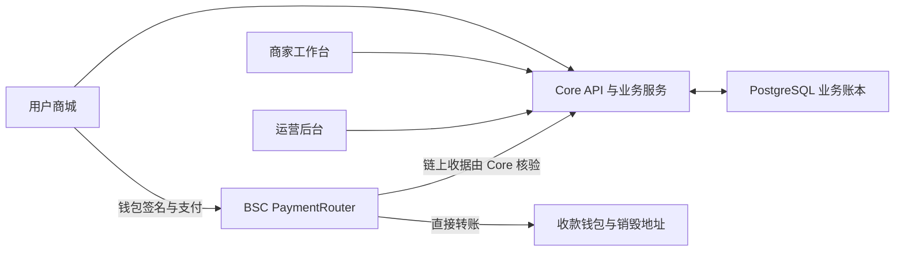

<p align="center">
  
</p>

<h1 align="center">24K Web3 Mall</h1>

<p align="center">
  开源 Web3 商城，连接钱包支付、商品交易与订单履约。<br />
  Open-source Web3 commerce with wallet payments, order fulfillment and auditable settlement.
</p>

<p align="center">
  <a href="LICENSE"></a>
  
  
  
</p>

<p align="center">
  <a href="#项目概览">项目概览</a> ·
  <a href="#系统架构">系统架构</a> ·
  <a href="#快速开始">快速开始</a> ·
  <a href="#开发文档">开发文档</a> ·
  <a href="CONTRIBUTING.md">参与贡献</a>
</p>

## 项目概览

**24K Web3 Mall** 是一个面向 BNB Smart Chain 的开源电商系统，包含用户商城、商家工作台和平台运营后台。项目将钱包身份、链上支付、商品与库存管理、订单履约和结算账本整合在同一个 TypeScript / Solidity monorepo 中。

项目不仅关注“如何用钱包付款”，也关注付款之后的业务流程：如何确认收款、完成发货、处理履约异常，以及核对商家应收和实际结算。开发者可以在此基础上研究、扩展或搭建自己的 Web3 商城。

### 核心能力

| 模块 | 能力 |
| --- | --- |
| 用户商城 | 移动端 DApp、钱包连接、商品浏览、组合支付与订单跟踪 |
| 商家工作台 | 商品与库存管理、发货与自提、应收与结算操作 |
| 运营后台 | 商家管理、订单监督、履约异常处理与运营风控 |
| 支付合约 | 签名支付意图、USDT / NPL 支付路由与资金分配 |
| 业务账本 | 只追加的复式记账、余额分层与结算状态追踪 |
| 链上核验 | 支付收据校验、确认深度、重组与替换交易处理、幂等保护 |

### 业务边界

- 当前 V2 围绕 BSC（chain ID `56`）设计，商品与商家应收以 USDT 计价，支付策略为 70% USDT 与 30% 等值 NPL。
- PaymentRouter 按规则将资金直接转入收款钱包及销毁地址；业务账本与商家结算由后端服务协同完成，不是全链上托管系统。
- BNM 是后端记账的业务积分，不是本项目发行的 ERC-20 代币。
- 履约流程包含发货、自提、换货、延期和仲裁；当前 V2 不提供业务退款模型。

金额、权限及状态机的规范定义见 [系统契约](docs/V2_SYSTEM_CONTRACT.md)。

## 系统架构



Core 维护身份、权限与业务状态；支付合约执行链上资金路由。后台任务负责收据核验、状态推进与结算协作。合约不会主动调用后端 API。

### 工作区

```text
mall-v2/                 用户商城 DApp
merchant-v2/             商家工作台
platform-v2/
  admin/                 平台运营后台
  contracts/             支付与业务合约
  server/                Core API 与业务服务
packages/core-artifacts/ 跨应用共享的 Core 发布产物
docs/                    需求、架构、接口与运行规范
scripts/                 工作区检查与维护工具
legacy/v1-npl-only/      只读 V1 源码存档，不参与 V2 运行
```

### 技术栈

| 层次 | 技术 |
| --- | --- |
| Web 应用 | React、TypeScript、Vite、ethers |
| 服务端 | Node.js 24、TypeScript、PostgreSQL、Redis、WebSocket |
| 智能合约 | Solidity、Foundry、OpenZeppelin Contracts |
| 工程与测试 | pnpm workspaces、Node Test Runner、Vitest、Playwright |

## 快速开始

### 环境要求

- Node.js `>=24.14.0 <25`
- pnpm `10.30.2`
- Foundry：运行合约测试时需要
- 独立的本地 PostgreSQL / Redis：运行相应后端与集成流程时需要

### 获取源码与基础检查

```bash
git clone https://github.com/Anghandev/mall.git
cd mall
pnpm install --frozen-lockfile --ignore-scripts

pnpm baseline:check
pnpm baseline:test
pnpm requirements:check
pnpm typecheck
pnpm micro:guard:test
```

安装命令默认不执行依赖安装脚本；需要原生构建步骤时，应先检查对应依赖。上述检查不是完整的业务环境验收。

### 启动前端

在独立终端中启动需要开发的应用：

```bash
# 用户商城：http://127.0.0.1:4311/mall/
pnpm --filter @abu24k/mall dev

# 商家工作台
pnpm --filter @abu24k/merchant dev

# 平台运营后台
pnpm --filter @abu24k/platform-admin dev
```

前端开发服务器不等于完整业务环境。钱包登录、真实支付与业务写入需要配置好的 Core 服务、数据库及链连接；缺失配置时，相关操作会拒绝执行。

### 配置 Core 服务

先阅读 [Core 开发说明](platform-v2/README.md) 和 [集成协议](docs/INTEGRATION_PROTOCOL.md)，参考 [.env.example](.env.example) 为本地进程配置环境变量，再启动：

```bash
pnpm --filter @abu24k/core start
```

Core 默认监听 `127.0.0.1:3000`，可通过 `HOST` / `PORT` 调整。入口读取进程环境变量，不会自动加载仓库根目录的 `.env`。请使用独立测试配置，不要连接生产数据库或使用真实资金钱包进行本地开发。

## 测试与校验

| 命令 | 用途 |
| --- | --- |
| `pnpm baseline:check` | 工作区结构、历史模块隔离与禁止跟踪文件检查 |
| `pnpm baseline:test` | 工作区检查器的回归测试 |
| `pnpm requirements:check` | 需求矩阵与规范文档一致性检查 |
| `pnpm typecheck` | 各工作区 TypeScript 类型检查 |
| `pnpm contracts:test` | Foundry 合约测试 |
| `pnpm database:check` | 数据层检查 |
| `pnpm database:postgres:check` | 独立 PostgreSQL 集成检查 |
| `pnpm micro:guard:test` | 微测试执行防护的本地回归测试 |
| `pnpm verify` | 运行组合校验门禁 |

数据库、浏览器及合约集成检查需要各自的本地前置条件。数据库测试必须使用可丢弃的测试数据库；配置缺失应当报错，而不是被当作成功。

部署、签名与广播脚本不属于本地冒烟测试。运行前必须另外确认网络、权限、预算与停止条件。局部测试通过不代表生产环境或主网已获安全认证。

## 开发文档

| 文档 | 内容 |
| --- | --- |
| [系统契约](docs/V2_SYSTEM_CONTRACT.md) | 资金规则、角色与业务状态机 |
| [API 规范](docs/V2_API_SPEC.md) | Core 接口与请求约定 |
| [数据模型](docs/V2_DATA_MODEL.md) | 数据结构、账本与一致性约束 |
| [合约规范](docs/V2_CONTRACT_SPEC.md) | 链上职责与支付规则 |
| [后台任务](docs/V2_WORKERS_SPEC.md) | 索引、核验与异步任务 |
| [集成协议](docs/INTEGRATION_PROTOCOL.md) | Core 与各产品端的协作边界 |
| [工作区基线](docs/WORKSPACE_BASELINE.md) | 包结构、依赖与验收要求 |
| [V1 隔离说明](docs/V2_LEGACY_ISOLATION_REPORT.md) | 历史代码存档与 V2 边界 |

## 安全与贡献

欢迎提交缺陷报告、测试改进、文档修正与功能提案。开始前请阅读 [贡献指南](CONTRIBUTING.md)；涉及资金、权限或状态机的改动，请附上针对性测试与影响说明。

安全问题请按照 [安全策略](SECURITY.md) 私下报告，不要在公开 Issue 中附上密钥、用户数据或可直接利用的生产细节。仓库不提供生产凭证、签名密钥或业务数据库；请勿重新提交旧备份中的私有运行数据。

## 开源许可

原创项目代码采用 [MIT License](LICENSE)，允许使用、修改、分发与商用。第三方组件、素材声明和商标权单独适用，详见 [第三方声明](THIRD_PARTY_NOTICES.md)。
